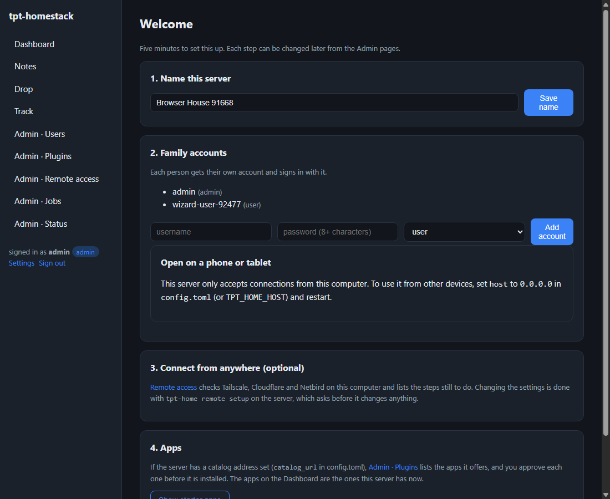
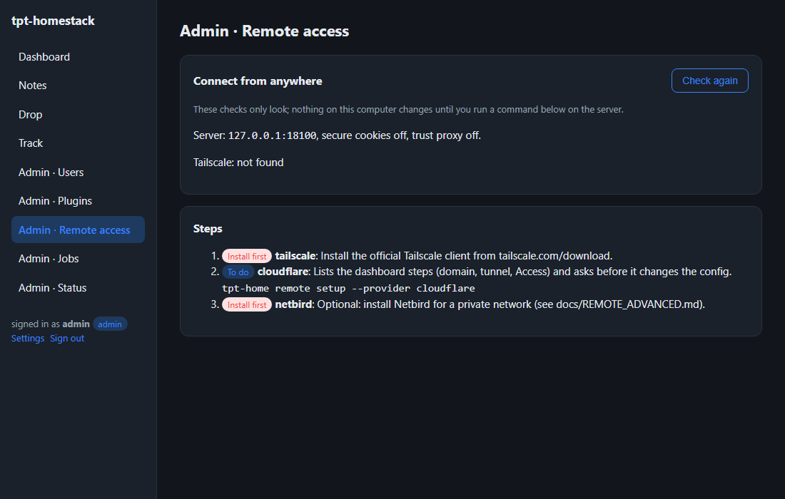
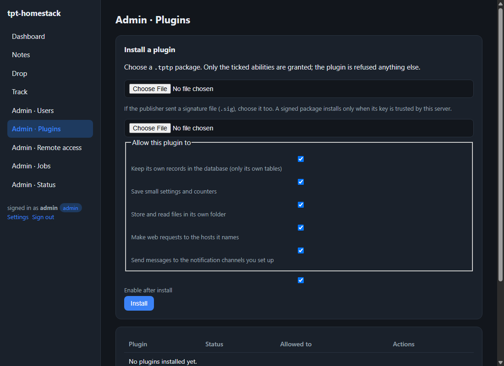

# Getting started (no programming needed)

This guide is for someone who wants apps running on a home computer. It assumes
you can open a terminal window and copy and paste a command. For what the server
does and how to run it for others, see [GUIDE.md](GUIDE.md).

Written for: a household admin who is comfortable with a computer but is not a
developer.

## 1. Set it up

1. **Get the program.** Put `tpt-home` (on Windows, `tpt-home.exe`) in a folder you
   will remember, such as `C:\homestack`.
2. **Open a terminal in that folder.** On Windows, click the address bar of the
   folder, type `powershell` and press Enter.
3. **Create the server's data:**

   ```sh
   .\tpt-home.exe init
   ```

   This creates a data folder, the database and the first admin account. It prints
   the admin password once. Write it down somewhere safe.

4. **Start the server:**

   ```sh
   .\tpt-home.exe run
   ```

   Leave this window open. The server stops when you close it.

## 2. Open it

1. In a browser on the same computer, go to **http://127.0.0.1:8080**.
2. Sign in as `admin` with the password from step 1.
3. You will be asked to choose a new admin password. Then the **welcome** page helps
   you name the server and add family members. See
   [FAMILY_SIGN_IN.md](FAMILY_SIGN_IN.md) for adding people.



## 3. Use it from a phone

By default the server answers only this computer. To use it from a phone:

1. Set `host` to `0.0.0.0` in `config.toml` in the data folder, then restart.
2. Open **Settings** in the app. The **Open on a phone or tablet** card shows an
   address and a code to scan.

Only do this on a network you trust, such as your home Wi-Fi. For access from
outside the house, read [REMOTE_ACCESS.md](REMOTE_ACCESS.md).

## 4. Keep it safe

- **Back up.** The admin pages can take a backup now. Scheduled backups are set with
  `backup_every_hours` in `config.toml`. Keep a copy somewhere else as well.
- **Keep the password.** A password that an admin set must be changed on first use;
  that is deliberate.
- **Remote access** is checked on **Admin · Remote access**. Nothing changes there
  until you run a command on the server, as the page explains.



- **Watch the status page.** **Admin · Status** shows the version, disk space, the
  last backup and any failing scheduled jobs.

## 5. Apps (plugins)



Apps are installed from a package file (`.tptp`) in **Admin · Plugins**, or picked
from the catalog on the same page when the server has a catalog address:

1. Choose the package. If the publisher sent a signature file (`.sig`), choose that
   too.
2. Tick only what the app needs. The page says what each ticked ability lets it do.
   Anything left unticked is refused.
3. Choose whether to enable it straight away, then **Install**.

You can disable an app at any time, or remove it. When you remove it, you choose
whether to keep its data.

## Troubleshooting

| What you see | What it means | What to do |
| --- | --- | --- |
| The server fails to start with an address-in-use error | Another program uses the port | Close it, or set `port` in `config.toml` |
| The page does not open from a phone | The server only listens on this computer | Set `host = "0.0.0.0"` and restart; check the firewall allows it |
| You are asked to change your password | The password was set by an admin | Choose a new password on the page |
| "this server installs only signed plugins" | The server requires signatures | Get the `.sig` file from the publisher, or ask the admin about the setting |
| "does not match any trusted plugin key" | The signature is not from a key this server trusts | Check you have the right package and signature; ask the admin to trust the key |
| The "Exposed to the network" notice | The server can be reached beyond this computer | Expected if you chose that on purpose. Otherwise set `host` back to `127.0.0.1` |
| A scheduled job shows as failing | Its last run ended with an error | Open **Admin · Jobs** for the message, fix the cause, then wait for the next run |
| No backups appear | Scheduled backups are off | Set `backup_every_hours` in `config.toml` |

If none of these fit, the server's output in the terminal window says what went
wrong. Copy the last lines when you ask for help.
